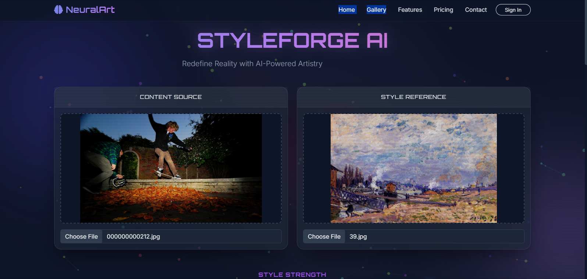
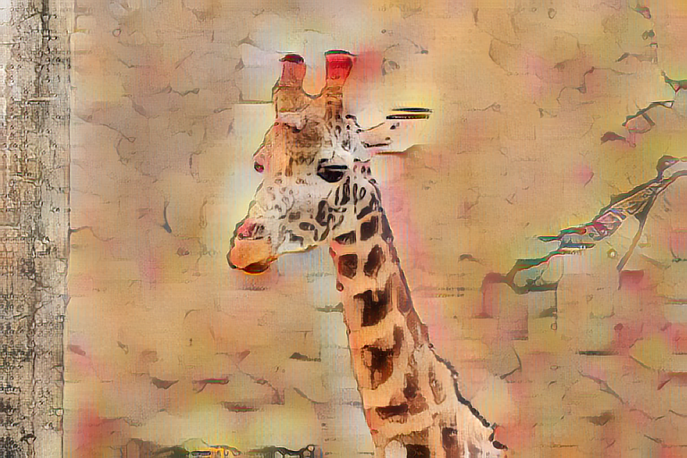

# NeuralArt — Neural Style Transfer



NeuralArt is a Flask web app for applying the visual style of one image to the
content of another. It uses Adaptive Instance Normalization (AdaIN), a
pretrained VGG encoder, and a trained decoder built with PyTorch.

Upload a content image and a style image, choose the style strength, and view or
download the generated result.

## Features

- Web interface for content and style image uploads
- Adjustable style strength (`0.0` to `1.0`)
- GPU inference when CUDA is available, with CPU fallback
- Bundled VGG encoder and decoder checkpoints
- Training script for training a decoder on image folders
- Model-generated examples in the web app

## Project structure

```text
.
├── app.py                         # Flask application and inference
├── train.py                       # Decoder training script
├── content_data/                  # Sample content images for training
├── style_data/                    # Sample style images for training
├── examples/                      # Generated example results for the UI
├── experiment/
│   └── decoder_final.pth          # Decoder checkpoint used by the app
├── static/
│   └── uploads/                   # Uploaded images and generated results
├── templates/
│   └── index.html                 # Web interface
└── utils/
    ├── models.py                  # VGG encoder and decoder definitions
    ├── utils.py                   # AdaIN, image dataset, and transforms
    └── vgg_normalised.pth          # Pretrained VGG weights
```

## Requirements

- Python 3.10 or newer
- PyTorch and torchvision
- Flask, Flask-WTF, Flask-Bootstrap, WTForms, Pillow, and tqdm
- Optional: a CUDA-capable GPU and compatible NVIDIA drivers for GPU inference

## Installation

From the project directory, create and activate a virtual environment:

```powershell
python -m venv .venv
.\.venv\Scripts\Activate.ps1
```

Install the project dependencies:

```powershell
python -m pip install --upgrade pip
python -m pip install -r requirements.txt
```

The requirements include PyTorch and torchvision. If you need a specific
PyTorch build, install the version recommended by the
[official PyTorch installation selector](https://pytorch.org/get-started/locally/)
for your operating system and CPU/CUDA setup.

## Run the web app

The repository should include both model checkpoints:

- `utils/vgg_normalised.pth`
- `experiment/decoder_final.pth`

Start the Flask development server from the project folder:

```powershell
python app.py
```

Open [http://localhost:5000](http://localhost:5000) in your browser. Select a
content image and a style image, adjust the style strength, then submit the
form. Generated results are saved under `static/uploads/`.

The app currently allows PNG, JPG, and JPEG uploads. The Flask development
server and its built-in debugger are intended for local development, not
production deployment.

## Training

`train.py` trains the decoder using content and style image folders. Each
folder should contain supported image files (`.jpg`, `.jpeg`, or `.png`) at
its top level.

The script's default dataset paths are specific to the original development
machine. Pass paths for your own datasets explicitly:

```powershell
python train.py `
  --content_dir ".\content_data" `
  --style_dir ".\style_data" `
  --experiment "my_experiment"
```

Training outputs, including arguments, checkpoints, and preview grids, are
written under `experiment/<experiment-name>/`. The script defaults to one
epoch; use options such as `--epochs`, `--batch_size`, and `--lr` to change
training settings. Run `python train.py --help` to see all available options.

## Example

The following result was generated by the included model:



The web app's Examples section also shows the content image and style reference
alongside each generated result.

## Render deployment

For a Render Web Service, use `pip install -r requirements.txt` as the build
command and `gunicorn --bind 0.0.0.0:$PORT app:app` as the start command. A
custom start command in the Render dashboard overrides the `Procfile`, so make
sure it binds to Render's `PORT`. The models are loaded on the first style
transfer request rather than during server startup; the first transfer may
take longer while the weights are loaded.
